<!-- The source of dokumentacja.pdf (at most 8 pages), built by `just package`. The ERD picture is
docs/erd.svg, its longer description docs/erd.md. The admin login in section 2 is filled in from the
platform's secrets file when the PDF is built; the repository keeps only the placeholders. -->

# Pomiary — warunki w lasach

<div class="doc-meta">

**Dokumentacja projektu, etap E2**

| | |
| --- | --- |
| Autor | Piotr Gugnowski |
| Nr indeksu | 320690 |
| Przedmiot | Zaawansowane aplikacje internetowe (2026Z) |
| Data | 13 października 2026 |

</div>

Aplikacja zbierająca i prezentująca serie pomiarowe z czujników: opady, temperaturę powietrza
i gleby oraz wilgotność gleby w trzech miejscach w pobliżu lasów (Warszawa, Suwałki, Chełm) —
12 serii, wartości co 6 godzin. Czujniki są emulowane przez generator danych, który czyta
[Open-Meteo](https://open-meteo.com/) (Weather data by Open-Meteo.com, CC BY 4.0) albo tworzy
syntetyczną krzywą, i wysyła wyniki przez API tak jak każdy czujnik.

## 1. Adres aplikacji i repozytorium

- Aplikacja i API (jeden host, API pod `/api`): https://pomiary-lasy.gugnowski.com
  — aplikacja jest wdrożona i dostępna (stan na 2026-10-12).
  Aplikacja działa na własnym klastrze Kubernetes autora za tunelem Cloudflare (HTTPS), nie na
  darmowym planie, więc nie jest usypiana po okresie bezczynności i nie ma zimnego startu, o którym
  trzeba by wspominać.
- Dokumentacja API (Swagger UI): `/api/docs` na tym samym hoście (sprawdzona za nginx, tak jak
  serwuje ją wdrożenie); kontrakt to `docs/spec/zai-api-26z.yaml`.
- Repozytorium: https://github.com/Manomenu/zaawansowane-aplikacje-internetowe-2026Z
  (gałąź `master`; status CI:
  https://github.com/Manomenu/zaawansowane-aplikacje-internetowe-2026Z/actions/workflows/ci.yml).

## 2. Logowanie administratora

| | |
| --- | --- |
| Nazwa użytkownika | `{{ADMIN_USERNAME}}` |
| Hasło | `{{ADMIN_PASSWORD}}` |

Konto działa do czasu wystawienia oceny.

## 3. Uruchomienie lokalne

### 3.1 Wersje narzędzi

Wersje, z którymi projekt był budowany i testowany (2026-10). Przypięte wersje są ustalone przez samo
repozytorium; dla pozostałych prawdopodobnie zadziała starsze wydanie, ale to te były sprawdzone.

| Narzędzie | Wersja | Do czego |
| --- | --- | --- |
| Python | 3.14 (`.python-version`; obraz to `python:3.14-slim`) | serwer |
| uv | 0.12.5 | zależności Pythona (`uv sync`) |
| Node.js | 24.20.0 lokalnie; obraz aplikacji webowej buduje się na `node:24-alpine` | aplikacja webowa |
| pnpm | 11.24.0 (`packageManager` w `pomiary_web/package.json`, przez corepack) | zależności aplikacji webowej |
| PostgreSQL | 17.11 (`postgres:17.11` w `compose.yaml` i `just db up`) | baza danych |
| nginx | 1.29 (`nginx-unprivileged:1.29-alpine`) | serwuje build aplikacji webowej, przekazuje `/api` dalej |
| just | 1.58.0 | polecenia (`justfile`) |
| podman + `podman compose` | podman 5.8.4; `podman compose` używa dostawcy docker-compose 5.5.0 | lokalna baza danych i stos kontenerów |
| Generator | Python 3.12 lub nowszy, tylko biblioteka standardowa | `pomiary_generator/` |

Stos: FastAPI + psycopg 3 z czystym SQL (bez ORM) + Argon2 (argon2-cffi); React 19 + Mantine +
Recharts + Vite, TypeScript w trybie strict.

### 3.2 Polecenia

Z katalogu głównego repozytorium, po sklonowaniu:

```sh
just sync        # zależności Pythona i aplikacji webowej z lockfile, hooki gita
cp pomiary_server/.env.example pomiary_server/.env
                 # potem odkomentować i ustawić w nim ADMIN_USERNAME i ADMIN_PASSWORD
just db up       # PostgreSQL na localhost:5453 (kontener podmana)
just server      # API na http://localhost:6220 (Swagger UI pod /docs); migracje przy starcie
just web         # aplikacja webowa na http://localhost:3220, przekazuje /api do serwera
```

Pierwszy administrator jest tworzony przy starcie serwera z `ADMIN_USERNAME` i
`ADMIN_PASSWORD` w `pomiary_server/.env` (tylko wtedy, gdy nie istnieje jeszcze żaden administrator);
należy zalogować się tymi danymi. Serwer deweloperski odpowiada bez prefiksu `/api`; deweloperski
serwer webowy i nginx dodają go i usuwają.

Alternatywnie cały stos w kontenerach, z tych samych obrazów, które uruchamia klaster, bez innego
narzędzia niż podman: `just up` → http://localhost:8092 (login `admin` / `local-only-password`, ustawione
w `compose.yaml` tylko dla tego lokalnego stosu); `just down` go zatrzymuje. Kontrole: `just check`
(bramka jakości: lintery, typy, testy jednostkowe, testy kontraktowe prowadzącego na lokalnym serwerze),
`just e2e` (testy w przeglądarce).

### 3.3 Generator danych (`pomiary_generator/`, F13)

Komunikuje się wyłącznie z API, z kluczem czujnika; nigdy nie dotyka bazy danych. Klucz jest
pokazywany jednorazowo przy rejestracji czujnika w panelu administratora. Adres i dane logowania mogą
pochodzić ze zmiennych środowiskowych (`POMIARY_API`, `POMIARY_API_KEY`, `POMIARY_ADMIN_USER`,
`POMIARY_ADMIN_PASSWORD`), dzięki czemu nie trafiają do historii powłoki ani do repozytorium.

```sh
cd pomiary_generator && python -m pomiary_generator send --help     # albo: just generator send --help
```

**`send`: jeden czujnik.** Uzupełnianie wstecz (`--count N`, znaczniki czasu z przeszłości) albo tryb
na żywo (`--interval 5s`, czas nadaje serwer).

| Parametr | Znaczenie |
| --- | --- |
| `--api URL`, `--api-key KEY` | adres API i klucz czujnika (zmienne środowiskowe powyżej); brak klucza to błąd |
| `--count N` | liczba wartości do wysłania (uzupełnianie wstecz) lub liczba wysyłek (na żywo; bez tego — bez końca) |
| `--step 1h` | uzupełnianie wstecz: odstęp między wartościami (`s`, `m`, `h`, `d`; domyślnie `1h`) |
| `--end now` | uzupełnianie wstecz: czas najnowszej wartości (ISO 8601 lub `now`) |
| `--interval 5s` | tryb na żywo: odstęp między wysyłkami |
| `--source synthetic\|open-meteo` | skąd pochodzą wartości (domyślnie `synthetic`) |
| `--shape constant\|random\|sine\|random-walk` | syntetyczne: krzywa (domyślnie `random`) |
| `--min A`, `--max B` | syntetyczne: zakres (domyślnie 0 i 100); wartości nigdy go nie opuszczają |
| `--period 24h`, `--noise X`, `--seed N` | syntetyczne: długość fali sinusoidy, szum, powtarzalne wartości |
| `--place warsaw\|suwalki\|chelm` | open-meteo: miejsce |
| `--quantity precipitation\|air-temperature\|soil-temperature\|soil-moisture` | open-meteo: wielkość |
| `--dry-run` | wypisuje, co zostałoby wysłane, niczego nie wysyła |

Odrzucona wartość (400/422) jest wypisywana wraz z wyjaśnieniem serwera, a działanie trwa dalej;
401 (zły klucz lub czujnik został wyrejestrowany) je zatrzymuje; kod wyjścia jest niezerowy, gdy
cokolwiek się nie powiodło. Przykład — wartość spoza zakresu do zademonstrowania F4:
`python -m pomiary_generator send --count 1 --shape constant --min 120 --max 120`.

**`seed`: dane przykładowe (F11).** Loguje się jako administrator, usuwa swoje 12 serii przykładowych
(3 miejsca × 4 wielkości, rozpoznawane po nazwie) razem z ich czujnikami i pomiarami, zakłada je od
nowa, rejestruje po jednym czujniku na serię i wysyła `--days` dni wartości, co `--step` (domyślnie 6 h), kluczem tego
czujnika. Każde uruchomienie daje więc świeże dane bez dubli; innych serii nie rusza. Klucze
czujników są wypisywane jednorazowo, na końcu.

```sh
export POMIARY_ADMIN_USER=admin POMIARY_ADMIN_PASSWORD=...
python -m pomiary_generator seed --api http://localhost:8092 --days 30     # 1 440 żądań (30 dni × 4 na dobę × 12 serii)
```

| Parametr | Znaczenie |
| --- | --- |
| `--api`, `--user`, `--password` | adres API i administrator (zmienne środowiskowe powyżej) |
| `--days 30` | liczba dni wartości na serię |
| `--step 6h` | odstęp między wartościami w pełnych godzinach (źródło jest godzinowe; co szósta godzina, licząc od najnowszej); `1h` wysyła wszystkie |
| `--source open-meteo\|synthetic` | domyślnie `open-meteo`; `synthetic`, gdy usługa nie działa |

## 4. Baza danych: ERD



PostgreSQL, schemat w `pomiary_server/pomiary_server/migrations/001_schema.sql` i `002_unique_names.sql` (migracje to
ponumerowane pliki SQL stosowane przy starcie i weryfikowane sumą kontrolną; dane przykładowe pochodzą
z generatora). Szczegóły: `docs/erd.md`.

- **`admins`** — konta; `username` unikalna, `password_hash` to Argon2id.
- **`sessions`** — sesje logowania; kluczem jest `token_hash`, SHA-256 nieprzezroczystego tokenu;
  `expires_at` ogranicza jego czas życia.
- **`series`** — nazwa (unikalna bez względu na wielkość liter), zakres `[min_value, max_value]` (`CHECK min_value < max_value`), kolor
  (`CHECK` `#RRGGBB`), opcjonalna `icon` (znacznik na wykresie) i `unit`.
- **`sensors`** — zarejestrowany czujnik przypisany do jednej serii, nazwa unikalna jak w serii; `api_key_hash` to unikalny SHA-256
  jego klucza; `last_measurement_at`.
- **`measurements`** — `value`, `measured_at` (w API: `timestamp`), seria i, gdy znany,
  czujnik.

| Relacja | Liczebność | ON DELETE |
| --- | --- | --- |
| `admins` → `sessions` | 1–N | CASCADE: żadnej sesji bez jej administratora |
| `series` → `sensors` | 1–N | CASCADE: usunięcie serii wyrejestrowuje jej czujniki |
| `series` → `measurements` | 1–N | CASCADE: wyniki znikają tylko razem z serią (kontrakt) |
| `sensors` → `measurements` | 0..1–N, nullable | SET NULL: wyrejestrowanie natychmiast unieważnia klucz, historia zostaje |

Indeks `(series_id, measured_at)` na `measurements` obsługuje `GET /measurements?series=&from=&to=`
(równość po serii, przeszukanie zakresu w czasie, wynik już posortowany). Hasła, tokeny sesji i
klucze czujników są przechowywane wyłącznie w postaci skrótów kryptograficznych.

## 5. Dwa elementy bezpieczeństwa (T5, B3)

### (a) Klucze API czujników: losowe, przechowywane jako SHA-256, pokazywane raz (T5.5)

- **Co.** Czujnik uwierzytelnia się nagłówkiem `X-API-Key`. Klucz to
  `secrets.token_urlsafe(32)` — 43 znaki z kryptograficznego generatora liczb losowych (256 bitów;
  kontrakt wymaga co najmniej 32 znaków). Baza przechowuje tylko `sha256(key)` w
  `sensors.api_key_hash` (`UNIQUE`). Surowy klucz jest zwracany jednorazowo, w odpowiedzi na
  `POST /sensors` (pole `apiKey`), i jednorazowo pokazywany w aplikacji webowej (okno dialogowe z
  przyciskiem kopiowania); żadna trasa nie zwraca go ponownie.
- **Gdzie.** `pomiary_server/pomiary_server/sensors/store.py`: `create_sensor` (generuje
  klucz, zapisuje `key_hash(key)`), `key_hash`, `sensor_for_key` (wyszukuje czujnik po skrócie kryptograficznym).
  `measurements/api.py`: `current_sensor`, zależność `POST /measurements`; seria jest
  brana z czujnika, nigdy z treści żądania, a sam token Bearer administratora daje 401.
  Web: `pomiary_web/src/sensors/KeyModal.tsx`.
- **Chroni przed.** Skradzioną kopią bazy danych lub kopii zapasowej: skrótów kryptograficznych nie da się
  zamienić z powrotem w klucze, więc nikt nie może wysyłać fałszywych pomiarów. 256-bitowego
  losowego klucza nie da się odgadnąć ani wyliczyć, dlatego szybki skrót kryptograficzny (SHA-256) tu wystarcza,
  inaczej niż w przypadku haseł. Wyrejestrowanie usuwa wiersz, więc klucz natychmiast przestaje
  działać (401); pomiary zostają z `sensor_id = NULL`.

### (b) Hasła z Argon2id i nieprzezroczyste tokeny sesji z wygasaniem (T5.1, T5.3)

- **Co.** Hasła są haszowane Argon2id (`argon2-cffi`, domyślne parametry z RFC 9106,
  losowa sól zapisana razem ze skrótem kryptograficznym). Logowanie (`POST /auth/login`) zwraca nieprzezroczysty losowy
  token (`secrets.token_urlsafe(32)`) ważny przez `TOKEN_TTL_SECONDS` (domyślnie 3600 s, zwracane jako
  `expiresIn`); baza przechowuje tylko jego SHA-256 i czas wygaśnięcia. Każde chronione żądanie
  wyszukuje token z warunkiem `expires_at > now()`. Wylogowanie usuwa sesję; zmiana hasła
  kończy wszystkie pozostałe sesje tego administratora.
- **Gdzie.** `pomiary_server/pomiary_server/auth/store.py`: `hasher` (`PasswordHasher`),
  `verify_password`, `UNKNOWN_USER_HASH`, `open_session` (usuwa też wygasłe sesje),
  `token_hash`, `admin_for_token`, `close_session`, `change_password`. `auth/api.py`:
  `current_admin` — zależność `CurrentAdmin`, którą deklaruje każda trasa modyfikująca.
- **Chroni przed.**
  - *Skradzioną kopią bazy:* hasła to solone, pamięciochłonne skróty kryptograficzne Argon2id (kosztowne do
    złamania metodą siłową), a tokeny sesji są przechowywane tylko jako SHA-256, więc zrzut bazy nie
    daje żadnego użytecznego logowania.
  - *Ponownym użyciem tokenu po wylogowaniu lub po upływie ważności:* wylogowanie usuwa wiersz
    sesji, więc token przestaje działać od razu (bezstanowy JWT tego nie potrafi bez listy
    blokad). Token, którego nikt nie wylogował, przestaje działać po `TOKEN_TTL_SECONDS`, bo każde
    żądanie sprawdza `expires_at > now()`; wygasłe wiersze usuwa kolejne logowanie (`open_session`).
  - *Odgadywaniem, jakie nazwy użytkowników istnieją, na podstawie czasu odpowiedzi:* dla nieznanej
    nazwy serwer i tak weryfikuje hasło względem `UNKNOWN_USER_HASH`, więc „brak takiego użytkownika”
    kosztuje tyle samo co „złe hasło”, a odpowiedź jest ta sama, 401.
  - Nie są ustawiane żadne ciasteczka, więc CSRF nie ma się czego uczepić; aplikacja webowa trzyma token w
    `sessionStorage` i wysyła go w `Authorization: Bearer`.

### Pozostałe trzy elementy T5

- **Zapytania parametryzowane (T5.2):** każde zapytanie w modułach `store.py` przekazuje wartości jako
  parametry `%s` do psycopg; jedyne f-stringi wstawiają do SQL stałe listy kolumn.
- **Autoryzacja każdej operacji modyfikującej na serwerze (T5.4):** każde POST/PUT/DELETE dla
  serii i czujników, wylogowanie i zmiana hasła zależą od `CurrentAdmin`
  (`series/api.py`, `sensors/api.py`, `auth/api.py`); pomiary można wysyłać tylko z
  kluczem czujnika (`current_sensor`); uwierzytelnienie jest sprawdzane przed walidacją treści. Ukrycie
  zakładek w interfejsie to tylko wygoda. Pytest obejmuje każdą trasę bez tokenu.
- **Mechanizm sesji/tokenów (T5.3)** to element (b) powyżej. Ponadto: każda odpowiedź API zawiera
  `X-Content-Type-Options: nosniff`, restrykcyjne `Content-Security-Policy` oraz
  `Referrer-Policy` (`problems.py`); nginx dodaje CSP strony (`pomiary_web/nginx.conf.template`).

## 6. Rozszerzenia kontraktu API

Kontrakt (`docs/spec/zai-api-26z.yaml`) pozostaje niezmieniony (jego suma kontrolna jest sprawdzana przez
bramkę jakości); wszystko poniżej jest ponad nim.

- **Dodana ścieżka `GET /api/measurements/stream`** (publiczna, `text/event-stream`, Server-Sent
  Events) — pomiary na żywo dla pulpitu (rozszerzenie X1). Opcjonalne `?series=1,3` (to samo
  parsowanie co w `GET /measurements`). Każdy nowy pomiar to zdarzenie `measurement`, którego `data`
  to ten sam JSON co w `GET /measurements/{id}`; komentarz `: ping` co 15 s podtrzymuje
  połączenie. Pomiar jest ogłaszany dopiero po zatwierdzeniu transakcji (PostgreSQL
  `LISTEN/NOTIFY`). Więcej niż `MAX_STREAMS` (domyślnie 50) otwartych strumieni dostaje `503` z
  `Retry-After`. `Accept: text/event-stream` jest akceptowane tylko na tej trasie.
- **Brak dodanych pól.** `icon`, `unit` (seria), `sensorId` (pomiar), `createdAt` i
  `lastMeasurementAt` (czujnik) oraz `apiKey` (w odpowiedzi rejestracji) są częścią
  kontraktu; serwer wypełnia `sensorId`, `createdAt` i `lastMeasurementAt`, które kontrakt
  oznacza jako opcjonalne. Nowa jest tylko ścieżka strumienia powyżej.
- **Bardziej restrykcyjnie, niż kontrakt wymaga minimalnie:**
  - `timestamp` (w treści oraz `from`/`to`) musi zawierać przesunięcie strefy (`Z` lub `+02:00`);
    bez niego jest 400, a nie zgadywane UTC; liczba nie jest traktowana jako czas Unix;
  - liczby muszą być ścisłymi liczbami JSON (`"5"` i `true` są odrzucane, NaN/Infinity także);
  - pomiar jest odrzucany (422), gdy wartość jest poza zakresem serii (granice
    włącznie) albo znacznik czasu wybiega o więcej niż 5 minut w przyszłość, a odrzucenie jest logowane
    na poziomie WARNING z czujnikiem, serią i wartością;
  - zmiana zakresu serii tak, że zapisane pomiary wypadają poza niego, daje 409;
  - każdy błąd to `application/problem+json` (RFC 9457) z `errors: [{field, message}]` dla
    walidacji; nieobsługiwane `Accept` to 406, treść niebędąca JSON-em to 415, `PUT`/`PATCH`/
    `DELETE` na pomiarze to 405;
  - nagłówki bezpieczeństwa w każdej odpowiedzi API (sekcja 5).

## 7. Użycie narzędzi AI

Wykorzystano asystentów AI, na co kurs zezwala:

- **Claude Code** (Anthropic): model **Claude Opus 5.5** do planowania, przeglądu kodu i
  integracji oraz **Claude Sonnet 5.5** w podagentach, które realizowały dobrze zdefiniowane
  kroki. Użyte przy pisaniu serwera, aplikacji webowej, generatora danych, testów, konfiguracji
  CI i wdrożenia oraz tej dokumentacji.
- **suwgit** ([github.com/Manomenu/suwalski-git](https://github.com/Manomenu/suwalski-git)),
  własne narzędzie autora: lokalny model językowy (Qwen) pisze w nim komunikaty commitów.

Autor **podejmował decyzje projektowe** (architektura, wybór technologii, zasady pracy w
repozytorium), **koordynował pracę** asystentów AI, zlecał im zadania i sprawdzał wyniki.
**Przy każdej zmianie uruchamiał bramkę jakości kodu** (typy, lintery, testy jednostkowe,
kontraktowe i w przeglądarce), sam lub zlecając to agentowi, a CI powtarza ją przy każdym pushu.
**Weryfikował też pracę agentów:** sprawdzał, czy zmiany w kodzie są takie, jak deklarował agent,
i ręcznie testował interfejs pod kątem zgodności z dokumentacją i z tymi deklaracjami. Autor **odpowiada za cały
oddany kod, w tym za jego poprawność i bezpieczeństwo**.

### 7.1 Źródła kodu pochodzącego z zewnątrz

Kurs dopuszcza dokumentację, samouczki i biblioteki, pod warunkiem wskazania źródeł zapożyczonego
kodu. Czego ten projekt nie napisał samodzielnie:

| Co | Skąd pochodzi | Do czego |
| --- | --- | --- |
| Szkielet repozytorium: bramka jakości, CI, Dockerfile, compose, chart Helm, migracje `db.py`, `api/client.ts` | własny publiczny szablon autora [Manomenu/solid-app-tpl](https://github.com/Manomenu/solid-app-tpl), skopiowany na początku (`docs/progress/F0-initialization.md`) | narzędzia wokół aplikacji; kod domenowy powstał dla tego projektu |
| Biblioteki serwera: FastAPI, Pydantic, pydantic-settings, Uvicorn, psycopg 3 (+ pool), argon2-cffi | PyPI; MIT / BSD / Apache-2.0 (LGPL-3.0 dla psycopg) | API HTTP, walidacja, ustawienia, dostęp do PostgreSQL, Argon2id |
| Biblioteki webowe: React, Mantine, Recharts | npm; MIT | SPA, jej komponenty, wykresy |
| Narzędzia testowe: pytest, Vitest, Playwright, axe-core (`@axe-core/playwright`) | PyPI / npm; MIT / Apache-2.0 / MPL-2.0 (axe-core) | testy jednostkowe, w przeglądarce i dostępności |
| Strona Swagger UI pod `/api/docs` | `get_swagger_ui_html` z FastAPI, wzorzec z dokumentacji FastAPI „Custom Docs UI Static Assets”; Swagger UI ładowany z jsDelivr | interaktywna dokumentacja API |
| `LISTEN`/`NOTIFY` dla strumienia na żywo | dokumentacja psycopg 3, „Asynchronous notifications” | `measurements/store.py` `listen()` |
| Dane pogodowe | [Open-Meteo](https://open-meteo.com/), CC BY 4.0 („Weather data by Open-Meteo.com”) | prawdziwe dane generatora (X2) |
| Renderowanie ERD, PDF tego dokumentu | Mermaid CLI; `marked` + drukowanie do PDF w Chromium | `docs/erd.svg`, `just package` |
| Kontrakt API i skrypt testowy kursu | prowadzący (`docs/spec/`, bez zmian, z sumą kontrolną) | zaimplementowany kontrakt i testy uruchamiane w bramce |

Żaden kod nie został skopiowany z projektów innych studentów ani z odpowiedzi z internetu, poza
wymienionymi wyżej wzorcami z dokumentacji. Wersje zależności są przypięte w `uv.lock` i
`pomiary_web/pnpm-lock.yaml`.

## 8. Technologie i uzasadnienie (T1–T4, T10, T11)

**Główny powód wyboru całego stosu:** autor miał już gotowy, przetestowany szablon do
rozpoczynania aplikacji, [solid-app-tpl](https://github.com/Manomenu/solid-app-tpl) (FastAPI +
React + PostgreSQL, z bramką jakości, CI, Dockerfile, compose i chartem Helm), używany
wcześniej w innych projektach autora (np. grzyby-mcp). Wybór stosu, na którym jest zbudowany,
oznaczał działający szkielet, testy i wdrożenie już pierwszego dnia. Czas poszedł na
wymagania kursu zamiast na konfigurowanie narzędzi. Autor zna też dobrze te narzędzia,
co ma znaczenie przy odpowiadaniu na pytania o kod. Każdy wybór musi się też sam bronić pod względem
wymagań:

| Wymaganie | Wybór | Dlaczego, na tle alternatyw |
| --- | --- | --- |
| T1 backend | **Python 3.14 + FastAPI** | Modele Pydantic walidują każde żądanie; to daje wprost podział kontraktu na 400 i 422. FastAPI generuje dokument OpenAPI, z którego generowane są typy TypeScript aplikacji webowej, więc klient i serwer nie mogą się rozjechać. Django wniosłoby ORM i panel administracyjny, których nie potrzebujemy. Express/NestJS lub Spring oznaczałyby drugi ekosystem obok generatora w Pythonie. |
| T2 frontend | **SPA w React 19 + Mantine + Vite**, wykresy w **Recharts** | React to frontend szablonu, a Mantine dostarcza dostępne komponenty formularzy (etykiety, fokus, okna dialogowe), które sprawdzają testy axe. Sam układ to CSS Grid + media queries w `app.css`, jak wymaga T2. Recharts rysuje SVG, który drukuje się ostro (F7) i pozwala na kształt znacznika dla każdej serii (T6). Biblioteka canvas (Chart.js) drukuje się nieostro i trudniej ją uczynić dostępną. |
| T3 REST API | kontrakt w podanej postaci, plus jedna dodana ścieżka | Skrypt testowy prowadzącego jest uruchamiany na lokalnym serwerze w bramce przy każdej zmianie, więc zgodność jest sprawdzana stale, a nie jednorazowo przy terminie. |
| T4 baza danych | **PostgreSQL 17, migracje w czystym SQL** | Typowane kolumny, klucze, ograniczenia `CHECK` i indeks czasu są zapisane jako SQL w `migrations/*.sql`, które służą też jako skrypt schematu do archiwum (B4). Wybrany zamiast SQLite ze względu na współbieżne zapisy (wiele czujników) i `LISTEN/NOTIFY`, które napędza strumień na żywo (X1). Bez ORM: każde zapytanie jest widoczne i sparametryzowane (T5.2). Ten sam PostgreSQL działa też na klastrze autora. |
| T10 wdrożenie | własny **klaster k3s** autora za **tunelem Cloudflare**, wdrażany przez Argo CD | Już hostuje inne aplikacje autora, jest darmowy, daje HTTPS bez otwierania portu i działa aż do oceny. Darmowy PaaS by usypiał, na co natrafiłyby testy prowadzącego. |
| T11 generator | **Python, tylko biblioteka standardowa** | Każdy uruchomi go zwykłym `python`, bez niczego do instalowania. To osobny program, więc komunikuje się z API dokładnie tak jak czujnik. |

## 9. Wykonane rozszerzenia

- **X1 wykres na żywo (SSE):** `GET /api/measurements/stream` (sekcja 6) i pulpit w
  `pomiary_web/src/dashboard/` — wartość wysłana przez generator pojawia się bez przeładowania strony.
- **X2 generator z prawdziwymi danymi:** `--source open-meteo` (sekcja 3.3), kod w
  `pomiary_generator/`; atrybucja w stopce strony i w README.
- **X3 testy w CI:** `.github/workflows/ci.yml` uruchamia bramkę jakości, testy w przeglądarce, a
  następnie buduje obrazy (status: https://github.com/Manomenu/zaawansowane-aplikacje-internetowe-2026Z/actions/workflows/ci.yml).
